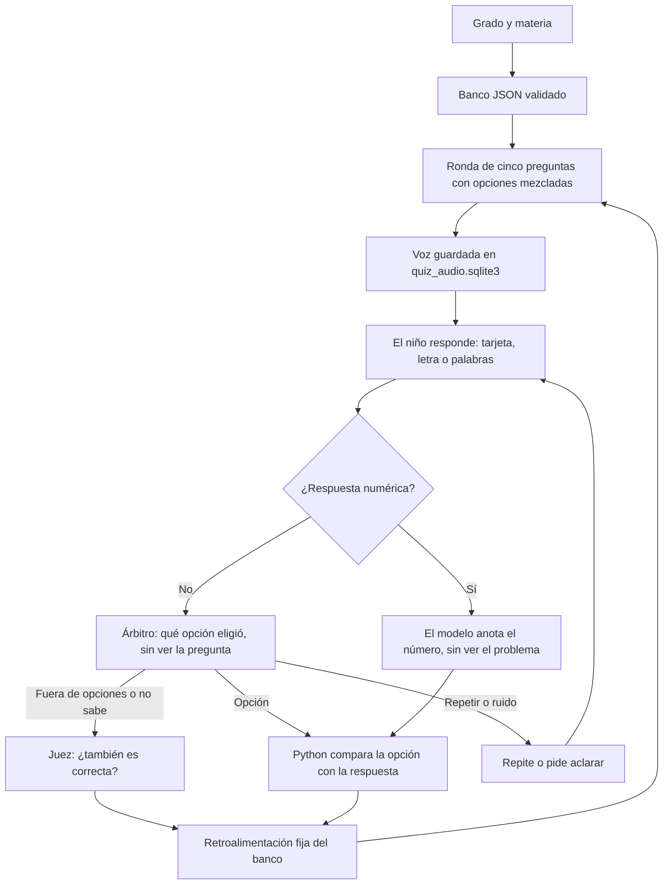

# Guía de IA para explicar el proyecto

Cimarrón conserva React, FastAPI, Ollama, Chroma y Supertonic. El chat institucional sigue con `gemma2:2b`. El juego de primaria usa otro modelo local, `qwen2.5:7b` (configurable con la variable `CIMARRON_QUIZ_MODEL`), y lo usa para una sola tarea: **interpretar lo que responde el niño**. Las preguntas ya no las genera el LLM: salen de un banco revisado, `backend/data/banco_preguntas.json`. No se entrenan pesos ni se hace fine-tuning; tampoco hay análisis de imágenes ni transcripción local del micrófono.

## Por qué cambió el diseño

La versión anterior generaba preguntas y distractores con Gemma a partir de un corpus recuperado por RAG, los revisaba con el mismo modelo y los guardaba en una caché. Durante el desarrollo aparecieron preguntas mal formuladas que el propio modelo aprobaba. Por indicación del maestro, el contenido pasó a un banco de 96 preguntas escritas y revisadas por personas, y el esfuerzo de IA se concentró en lo que no puede resolverse con una lista: entender a un niño que responde hablando, con sus palabras, dudas y errores del reconocimiento de voz.

## Recorrido para demostrar el código

Abre estos archivos en este orden. Las rutas de esta guía parten de la raíz de `Proyecto_Cimarron`.

| Orden | Archivo y punto de entrada | Qué explicar al mostrarlo |
| --- | --- | --- |
| 1 | [backend/data/banco_preguntas.json](../backend/data/banco_preguntas.json) | El contenido del juego: cada pregunta tiene `id`, `subject`, `min_grade`/`max_grade`, `prompt`, `answer`, tres `distractors` y `explanation`. Se edita a mano; [la guía del banco](GENERACION_PREGUNTAS.md) explica cómo. |
| 2 | [backend/quiz_bank.py](../backend/quiz_bank.py), `BankQuestion`, `load_bank()` y `to_question()` | Valida cada fila con Pydantic (materia, grados, longitudes, cuatro opciones distintas, ids únicos) y la convierte en pregunta de juego. Mezcla las opciones con una semilla igual al `id`: el orden es estable entre partidas, así la narración se sintetiza una sola vez, y la respuesta correcta no ocupa una letra fija. Si `answer` es un número en dígitos, la pregunta es numérica. |
| 3 | [backend/quiz_bank.py](../backend/quiz_bank.py), `BankQuestionProvider.generate_round()` y `warm_audio()` | Arma la ronda: en «Un poco de todo», una pregunta de cada una de las cinco materias; en una materia, cinco preguntas distintas de su grado. Al arrancar, un hilo de fondo sintetiza las voces que falten y las guarda en `backend/quiz_audio.sqlite3` (`AudioCache`). |
| 4 | [backend/quiz_narration.py](../backend/quiz_narration.py), `question_narration()` y `feedback_texts()` | El texto hablado de la pregunta con sus letras A–D y la retroalimentación fija de acierto o error («¡Muy bien!…», «Buen intento. La respuesta es…»), armada con la `explanation` del banco. El LLM no redacta la retroalimentación. |
| 5 | [backend/quiz_dialogue.py](../backend/quiz_dialogue.py), `choice_prompt()` y `choice_schema()` | El árbitro: recibe las cuatro opciones y la transcripción, **sin la pregunta**, y devuelve qué opción eligió el niño o una de cuatro categorías especiales. |
| 6 | [backend/quiz_dialogue.py](../backend/quiz_dialogue.py), `open_judgment_prompt()` | El juez: solo se consulta cuando el niño propuso algo fuera de las opciones o el árbitro lo marcó como «no sabe». Este sí ve la pregunta y la respuesta esperada, y decide si la idea también es correcta. |
| 7 | [backend/quiz_dialogue.py](../backend/quiz_dialogue.py), `number_choice_prompt()` y `assess_number()` | La ruta numérica: el modelo solo anota el número (o la letra) que dijo el niño, sin ver el problema; Python lo compara con la respuesta. |
| 8 | [backend/quiz_dialogue.py](../backend/quiz_dialogue.py), `assess_open_answer()` | Une las tres consultas y traduce el resultado a un estado: `correct`, `incorrect` o `unclear`. |
| 9 | [backend/quiz_llm.py](../backend/quiz_llm.py), `OllamaQuizEvaluator.evaluate()` | Llama a `assess_open_answer()` con temperatura 0, salida JSON restringida por esquema y 15 segundos por consulta. Si Ollama falla, lanza `QuizModelUnavailable` y la pregunta queda pendiente. |
| 10 | [backend/quiz_engine.py](../backend/quiz_engine.py), `QuizService.start()`, `answer()` y `next()` | Mantiene cada sesión en memoria: puntos, turno, aclaraciones y respuestas ya calificadas. `unclear` conserva la pregunta; `correct` suma un punto; `incorrect` cierra la pregunta sin sumarlo. |

La entrada desde la interfaz está en [backend/quiz_api.py](../backend/quiz_api.py): `/quiz/prepare`, `/quiz/start`, `/quiz/answer`, `/quiz/next` y `/quiz/end`. Si la respuesta ya tiene voz guardada la reutiliza; si no, la sintetiza en ese momento. [frontend/src/App.jsx](../frontend/src/App.jsx), especialmente `requestQuiz()`, conecta con esas rutas. `GET /health` en [backend/main.py](../backend/main.py) informa si el modelo del juego está instalado en Ollama.

Para mostrar la parte visual, abre [QuizPanel.jsx](../frontend/src/components/QuizPanel.jsx) (grado, materia, pregunta y resultado), [QuizAnswers.jsx](../frontend/src/components/QuizAnswers.jsx) (tarjetas A–D) y [quizPreparation.js](../frontend/src/quizPreparation.js) (consulta `/quiz/prepare`; con el banco, la ronda está lista de inmediato). [SpeechButton.jsx](../frontend/src/components/SpeechButton.jsx) captura texto o transcripciones del navegador; el modelo recibe texto, no el audio del micrófono. Pulsar una tarjeta envía su texto por la misma ruta que una respuesta hablada.

Para mostrar la voz, abre [backend/tts_engine.py](../backend/tts_engine.py) (Supertonic), `AudioCache` en `quiz_bank.py` y `playAudioWithMouthSync()` en `App.jsx` (reproducción y animación).

El contexto institucional del chat continúa en [backend/conocimiento.txt](../backend/conocimiento.txt), indexado por `ingest_knowledge.py` y consultado por `cimarron_agent.py`. El juego no usa RAG.

Puedes presentar el trabajo así: «Las preguntas vienen de un banco revisado por docentes. La IA se dedica a entender lo que contesta el niño: decide qué opción quiso decir aunque use otras palabras, se corrija o dude, y lo hace sin ver la pregunta para no inclinarse hacia la respuesta correcta. Si contesta algo fuera de las opciones, un segundo paso juzga si también es válido; en matemáticas, el modelo solo escucha el número y Python hace la comparación. Medido con respuestas de ejemplo, acierta 102 de 105 y 85 de 87 en un conjunto de validación, pero todavía puede equivocarse».



## 1. Dos modelos, contextos separados

En `backend/ollama_client.py`:

```python
MODEL_NAME = 'gemma2:2b'
QUIZ_MODEL_NAME = os.getenv('CIMARRON_QUIZ_MODEL', 'qwen2.5:7b')
ollama_client = OllamaClient()
quiz_client = ollama_client if QUIZ_MODEL_NAME == MODEL_NAME else OllamaClient(model_name=QUIZ_MODEL_NAME)
```

El chat usa `ollama_client` y el juego usa `quiz_client`. Se eligió `qwen2.5:7b` para el juego porque sigue instrucciones y elige entre opciones con mucha más precisión que `gemma2:2b`. Ollama mantiene cada modelo cargado hasta 30 minutos después de usarlo, así que en la feria conviene una máquina con memoria para los dos. El cliente no guarda historial; cada participante del juego conserva solo su sesión.

Cada cliente tiene su `InferenceQueue`, que serializa sus peticiones y da preferencia a las interactivas. Con el banco ya no hay preparación de preguntas en segundo plano compitiendo con el juego.

## 2. El banco de preguntas

`load_bank()` falla al arrancar si una fila no cumple el esquema: así un error al editar el JSON se detecta antes de recibir niños, no a mitad de una ronda. `to_question()` mezcla las opciones con `random.Random(row.id)`; el mismo `id` siempre produce el mismo orden. Hay una prueba que verifica que, en el banco completo, la respuesta correcta aparece en las cuatro posiciones.

La materia «Un poco de todo» toma una pregunta de cada materia (Matemáticas, Ciencias naturales, Geografía, Biología y Español) en orden aleatorio. Una materia sola toma cinco preguntas distintas cuyo rango de grados incluya el del niño. `status()` responde `ready` cuando hay suficientes y `unavailable` si faltan.

## 3. Interpretación de la respuesta

Esta es la parte de IA del juego. Todas las consultas piden JSON con un esquema que Ollama obliga a respetar, a temperatura 0, y tratan lo que dijo el niño como datos, no como instrucciones.

**Opciones de texto: el árbitro.** `choice_prompt()` recibe las cuatro opciones y la transcripción, pero no la pregunta ni cuál es la correcta. Primero resume lo que dijo el niño con sus palabras (si se corrige, se queda con lo último) y después elige la opción cuyo *significado* coincide: la letra («la be»), el texto, un sinónimo, un diminutivo, una descripción o una duda («creo que…»). El esquema solo admite `A) …` a `D) …` o una de cuatro categorías:

| Categoría | Cuándo | Qué pasa |
| --- | --- | --- |
| `PEDIR_REPETIR` | «repítemela», «no escuché» | `unclear`; se repite la narración con su audio ya guardado. |
| `NO_SABE` | «no sé», «ni idea» | Pasa por el juez; si no hay idea válida, `incorrect` con la explicación. |
| `RUIDO_O_INDECISION` | ruido, «eeh», dos opciones sin elegir, «ponme el punto» | `unclear`; pide la letra o la respuesta. |
| `RESPUESTA_FUERA_DE_OPCIONES` | propone otra cosa | Pasa por el juez. |

No mostrarle la pregunta es una decisión deliberada: un modelo que conoce la respuesta tiende a «ayudar» y a leer en lo que dijo el niño la opción correcta. Sin la pregunta, solo puede decidir qué opción se parece a lo dicho. Cuando elige una opción, Python compara esa opción con `answer`; nunca se comparan las palabras del niño con un texto.

**El juez.** `open_judgment_prompt()` sí recibe la pregunta, la respuesta esperada y la explicación, junto con la idea que resumió el árbitro. Razona en una oración y decide si la idea también es correcta, por ejemplo un ejemplo válido distinto de la opción. «No sabe» también pasa por el juez para que una respuesta real mal clasificada no le quite el punto al niño.

**Números.** Las preguntas cuya respuesta es un número usan `number_choice_prompt()`, que recibe únicamente la transcripción: ni el problema ni las opciones. El modelo anota el número final que dijo el niño («siete, no, mejor ocho» → 8; «tiene seis patitas» → 6), o la letra si eligió una. Python convierte la letra en el valor de esa opción y compara con la respuesta. Así el modelo no puede resolver el problema por su cuenta y darle al niño un resultado que no dijo.

**Retroalimentación.** Los textos de acierto y error se arman con la `explanation` del banco y se sintetizan con anticipación. El modelo no escribe lo que dice el Cimarrón, así que no puede inventar explicaciones ni responder en inglés. Las aclaraciones (`unclear`) conservan la pregunta y no suman ni restan; cada intervención se interpreta por sí sola.

## 4. Voces guardadas

`BankQuestionProvider.warm_audio()` corre al arrancar el backend (`lifespan` en `main.py`). Para cada pregunta sintetiza tres textos, la narración con sus opciones y las dos retroalimentaciones, y los guarda en `backend/quiz_audio.sqlite3`, excluido de Git. La clave de cada audio es un hash del texto y del archivo `tts_engine.py`: si se edita una pregunta o se cambia la voz, solo se vuelve a sintetizar lo que cambió. La primera vez son casi 300 audios y tarda más; después el arranque encuentra todo guardado. Si una voz todavía no está lista, la API la sintetiza en el momento.

## 5. Sesiones y recuperación de errores

`QuizService` guarda las sesiones en memoria (caducan a las dos horas, máximo 500). Un candado por sesión evita calificar dos veces la misma pregunta; reenviar una respuesta ya calificada devuelve el mismo resultado y no duplica puntos. Un fallo de Ollama devuelve 503 y deja la pregunta pendiente; no se cambia en silencio a una comparación de texto.

El frontend abre el micrófono después de hablar y avanza después de la retroalimentación. El reconocimiento de voz es el del navegador; no se incorporó STT local y no debe afirmarse funcionamiento offline del micrófono en todos los navegadores.

## 6. Cómo se mide

[backend/scripts/check_interpretation_live.py](../backend/scripts/check_interpretation_live.py) toma casos con la forma `{"bank_id", "nino_dijo", "esperado"}`, los evalúa con el modelo real y reporta aciertos y tiempos. Hay dos conjuntos en `backend/tests/fixtures/`:

| Conjunto | Casos | Preguntas del banco | Resultado medido |
| --- | --- | --- | --- |
| `respuestas_ninos.json` | 105 | 27 | 102/105 (97 %) |
| `respuestas_ninos_validacion.json` | 87 | 26 | 85/87 (98 %) |

Los casos incluyen sinónimos y diminutivos («el solecito»), letras («la b de burro»), errores de pronunciación («evaporizacion»), autocorrecciones, dudas entre dos opciones, «no sé», peticiones de repetir, ruido e intentos de pedir el punto. El valor `not_correct` significa que cualquier estado menos `correct` es aceptable. Algunas frases cortas de los conjuntos («la be», «la ce», «tres», «ni idea», «tiene seis patitas») aparecen también como ejemplos en los prompts, lo que puede inflar un poco el resultado. Desde `backend/`:

```bash
./venv/bin/python scripts/check_interpretation_live.py
./venv/bin/python scripts/check_interpretation_live.py tests/fixtures/respuestas_ninos_validacion.json
```

Necesitan Ollama abierto con `qwen2.5:7b`. Las pruebas unitarias (`./venv/bin/python -m unittest discover -s tests -v`) usan dobles de prueba en lugar del modelo; comprueban el banco, las rondas, el audio, la puntuación y la concurrencia, no la precisión de la interpretación.

## Archivos que debes ubicar

| Archivo | Responsabilidad |
| --- | --- |
| `backend/data/banco_preguntas.json` | Las 96 preguntas del juego. |
| `backend/quiz_bank.py`, `quiz_curriculum.py` | Validación del banco, rondas, materias y caché de voces. |
| `backend/quiz_narration.py` | Texto hablado de pregunta, opciones y retroalimentación. |
| `backend/quiz_dialogue.py`, `quiz_llm.py` | Árbitro, juez, ruta numérica y llamada al modelo. |
| `backend/ollama_client.py`, `inference_queue.py` | Modelos, transporte, tiempos y prioridad. |
| `backend/quiz_engine.py`, `quiz_api.py` | Cinco turnos, puntuación y rutas HTTP. |
| `backend/main.py`, `tts_engine.py` | Síntesis de voces al arrancar y voz protegida ante concurrencia. |
| `backend/scripts/check_interpretation_live.py` | Medición de la interpretación con el modelo real. |
| `frontend/src/components/QuizPanel.jsx`, `components/QuizAnswers.jsx`, `quizPreparation.js` | Juego, tarjetas y consulta de disponibilidad. |
| `frontend/src/App.jsx` | Audio, voz automática y comunicación con la API. |

Siguen en disco, pero el juego actual ya no los usa: `quiz_generation.py`, `quiz_generation_prompts.py`, `quiz_preparation.py` (solo se importa su excepción `QuizPreparing`), `quiz_cache.py`, `quiz_knowledge.py`, `data/educacion_primaria.json`, el índice `chroma_education/`, la caché `quiz_cache.sqlite3` y los scripts `prepare_quiz.py`, `check_prepared_round_live.py` y `check_quiz_generation_live.py`. `quiz_prompts.py`, `quiz_concepts.py` y `quiz_language.py` pertenecen a la ruta de evaluación anterior que `quiz_llm.py` conserva para preguntas sin `answer_kind`; las del banco no pasan por ella.

## Cómo responder al asesor

**¿Qué hace la IA?** Interpreta respuestas habladas de niños: decide qué opción quisieron decir, reconoce cuándo piden repetir, no saben o solo hacen ruido, y juzga respuestas fuera de las opciones. No genera las preguntas ni la retroalimentación.

**¿Por qué no genera las preguntas?** Porque un modelo local pequeño producía preguntas confusas que él mismo aprobaba. Un banco revisado garantiza que el contenido sea correcto y adecuado al grado; la IA se aplica donde una regla fija no alcanza.

**¿Hay hardcoding?** El contenido del juego está escrito a mano a propósito, en un JSON que cualquier docente puede editar. La interpretación no usa listas de sinónimos ni comparaciones de texto: los ejemplos del prompt ilustran el criterio con opciones inventadas («la vaca, el pájaro, el pez, la piedra») y frases genéricas. Python solo compara la opción elegida, o el número extraído, con la respuesta.

**¿Qué tan bien funciona?** 102/105 y 85/87 en dos conjuntos de respuestas de ejemplo escritas para el proyecto. Son frases imaginadas, no grabaciones de niños reales; falta medirlo en la feria, con micrófono físico y ruido de fondo, y la interpretación sigue necesitando supervisión docente.
